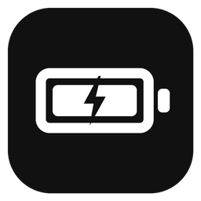
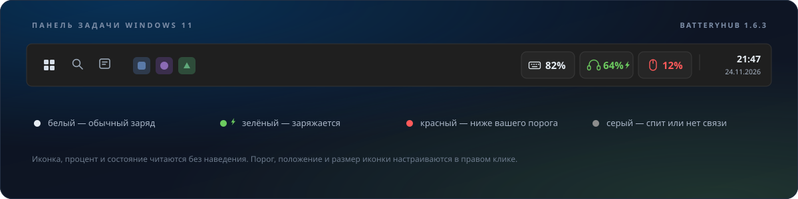
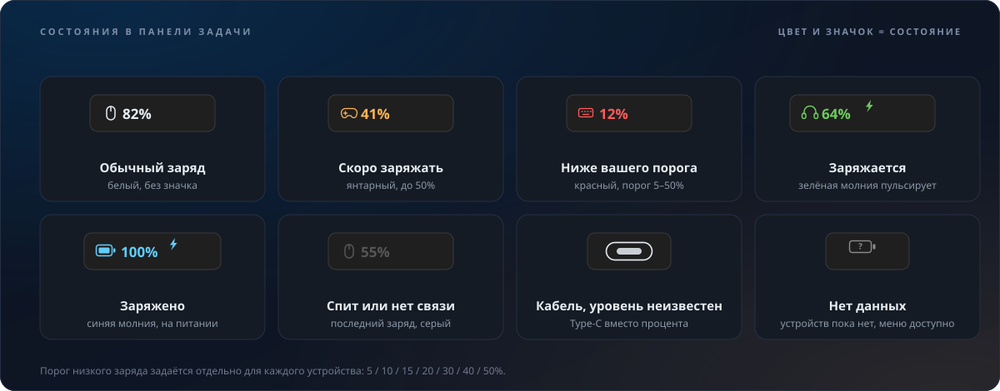
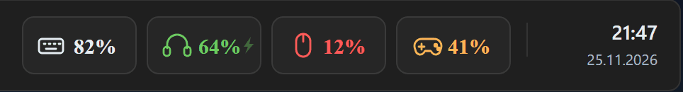
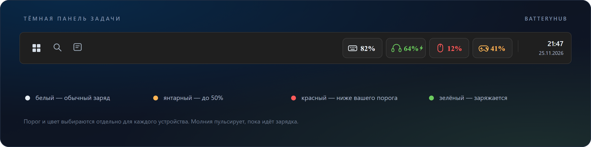
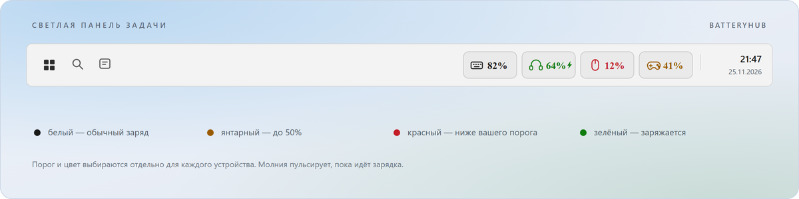
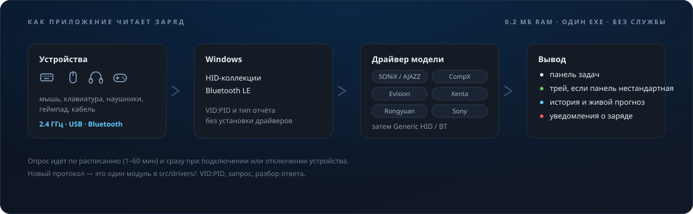

# BatteryHub — коротко по-русски

<p align="center">
  
</p>

<p align="center">
  <b>Заряд мыши, клавиатуры, наушников и геймпада — на панели задач Windows 10/11.</b><br>
  <sub>Один exe на Rust. Без службы, драйверов и фирменного софта.</sub>
</p>

<p align="center">
  <a href="../../releases/latest"></a>
  
  
  
</p>

<p align="center">
  
</p>

<p align="center">
  <a href="../../releases/latest"></a>
</p>

Полное описание, скриншоты и список изменений — в [README.md](README.md).

## Что показывает

- **Проценты рядом с часами** — иконка устройства и заряд, без наведения мышью.
- **Цвет состояния** — красный ниже вашего порога, янтарный до 50%, пульсирующая зелёная молния при зарядке, синяя при 100%, серый во сне.
- **Свой порог** для каждого устройства: 5 / 10 / 15 / 20 / 30 / 40 / 50%.
- **История заряда** — 24 часа / 7 / 30 дней, скорость разряда и время до нуля.
- **Месяц как на ладони** — heatmap 24 часа × 30 дней: видно, в какие часы садится.
- **Метки событий** — «на зарядке» и «снято» прямо на графике.
- **Плавная смена периода** — 24 ч / 7 / 30 дней без рывка.
- **Живой прогноз** — «~6 ч» до нуля в подсказке, когда уже есть история.
- **Уведомления** — низкий заряд, начало зарядки, 100%; режим «Не беспокоить».
- **Свои иконки** — PNG/ICO вручную, поиск по названию с вырезанием фона, размер 12–32 px.
- **Трей-режим** — если панель задач вертикальная или нестандартная.
- **Русский и английский**, автозапуск и проверка обновлений.

## Состояния

<p align="center">
  
</p>

<p align="center">
  
  <br>
  <sub>Молния пульсирует, пока идёт зарядка. Анимация отключается вместе с эффектами Windows.</sub>
</p>

### Тёмная и светлая панель

| Тёмная | Светлая |
|:---:|:---:|
|  |  |

## Устройства

- **AJAZZ AJ159 APEX** и AJ-серия на SONiX — 2.4 ГГц, `3151:5007`.
- **Dark Project HS5 V2** — по Bluetooth. Донгл 2.4 ГГц заряд не передаёт.
- **Sony DualSense / DualShock 4** — USB или Bluetooth.
- **AULA F75 / F87 Pro / F99** — 2.4 ГГц, `3554:FA09`.
- **Attack Shark** — Xenta `1D57:FA60` и приёмники Rongyuan.
- **WOBKEY Rainy 75 Pro** — USB `320F:5055` или 2.4 ГГц `320F:5088`.
- **IO by Red Square Aurora** — приёмник `3554:FB08` или кабель `3554:FB09`.
- **VXE R1 SE+** — приёмник `373B:1085` или кабель `3554:F58F`; R1 Pro Max и VGN Dragonfly 4K читаются тем же протоколом.
- **VXE V1 / Siren V1** — по Bluetooth, если Windows отдаёт уровень заряда. Донгл 2.4 ГГц передаёт только звук.
- Любые другие устройства, которые BatteryHub умеет читать.

Подробная таблица с состоянием проверки — в [README.md](README.md#поддерживаемые-устройства).

## Как это работает

<p align="center">
  
</p>

Приложение читает те же HID-отчёты, что и фирменный софт, через Win32 HID API. Драйверы идут по цепочке и проверяют свой `VID:PID`, в конце — Generic HID/Bluetooth. Опрос идёт по расписанию (1–60 мин) и сразу при подключении или отключении.

## Запуск

Готовый установщик: [Releases](../../releases/latest) — `BatteryHub-Taskbar-Setup-v1.7.0.exe`.

Или из исходников:

```powershell
cargo build --release
.\target\release\batteryhub-taskbar.exe
```

Установка в `%LOCALAPPDATA%\Programs\BatteryHub\Taskbar` с автозапуском:

```powershell
.\release\BatteryHub-Taskbar-Setup-v1.7.0.exe /install /S /autostart=yes
```

## Язык

Правый клик по процентам → **Язык** → **English** или **Русский**. Выбор сохраняется в
`HKCU\Software\BatteryHub\Taskbar\Language`. При первом запуске язык берётся из языка Windows.

## Лицензия

GPL-3.0-or-later. Основа — [BatteryHub (Rust)](https://github.com/ferloom/Wireless-Device-Battery-Monitor), переписанный с C++ BatteryHub by krisgfx9. Полный текст лицензии — в [LICENSE](LICENSE).
