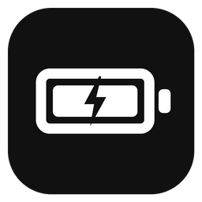
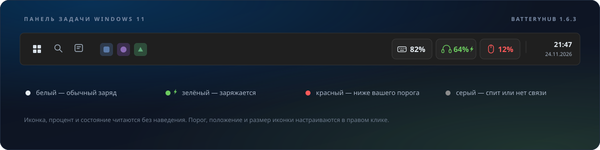
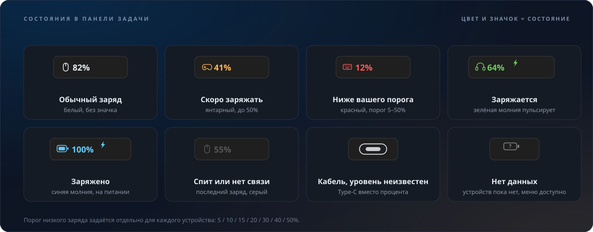
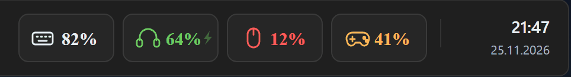
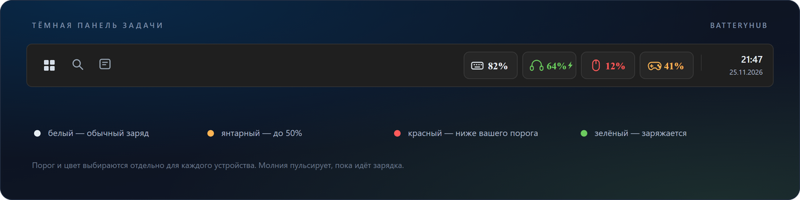
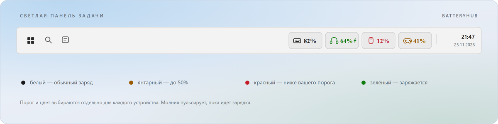
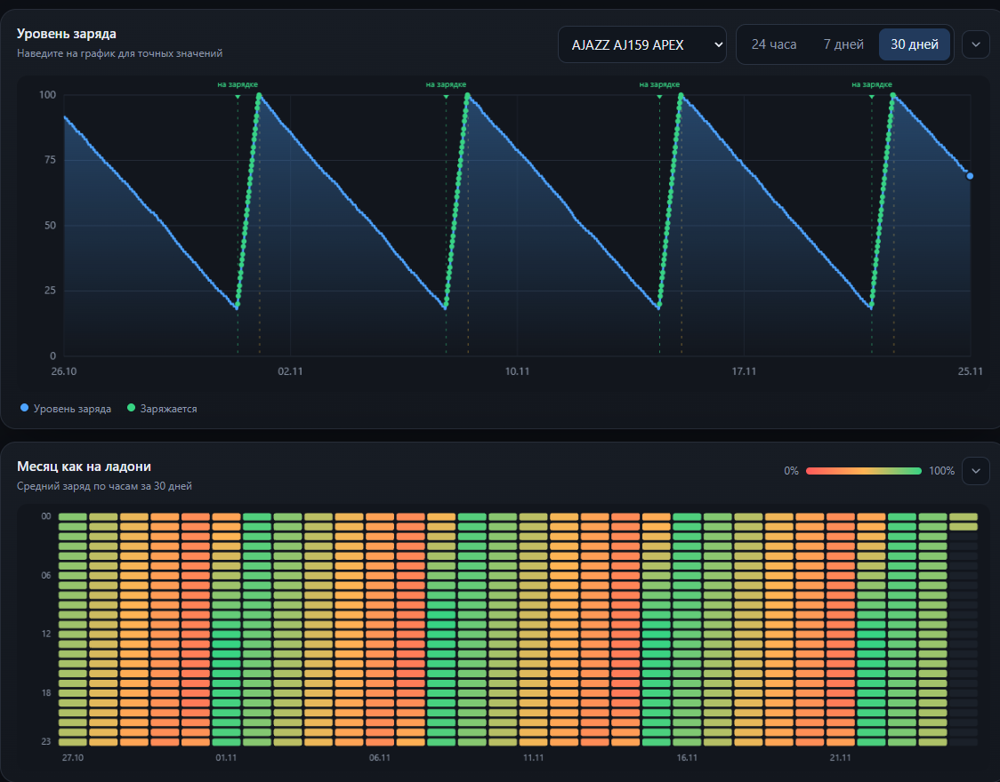
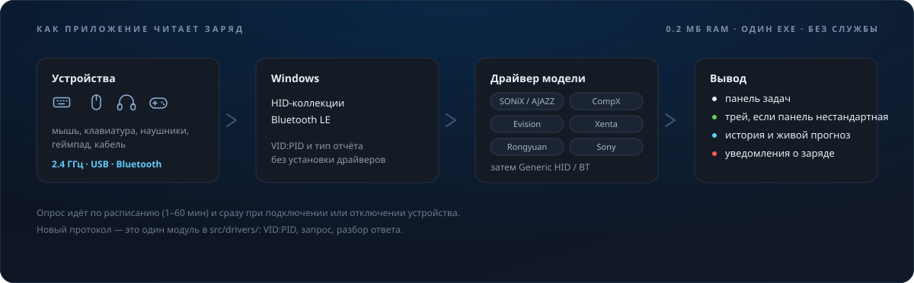

# BatteryHub

<p align="center">
  
</p>

<p align="center">
  <b>Заряд беспроводных устройств — прямо на панели задач Windows 10/11.</b><br>
  Мышь, наушники, геймпад и клавиатура. Без тяжёлого софта производителей.<br>
  <sub>Wireless device battery levels on the Windows taskbar — tiny Rust app, no vendor software.</sub>
</p>

<p align="center">
  <a href="../../releases/latest"></a>
  
  
  
  
  
</p>

<p align="center">
  
</p>

<p align="center">
  <a href="../../releases/latest"></a>
</p>

<p align="center">
  <a href="#установка">Установка</a> ·
  <a href="#поддерживаемые-устройства">Устройства</a> ·
  <a href="#как-это-работает">Как это работает</a> ·
  <a href="#сборка">Сборка</a> ·
  <a href="README-RU.md">Короткая версия по-русски</a>
</p>

> **Что это:** форк BatteryHub (Rust) с драйверами для **AJAZZ AJ159 APEX**, **Dark Project HS5 V2**, **AULA F75/F87/F99**, **Attack Shark**, **WOBKEY Rainy 75 Pro**, **IO by Red Square Aurora** и **VXE**, плюс русский интерфейс. Ниже — установка, состояния и полный список устройств.

---

## Коротко

| <sub>ПАМЯТЬ</sub><br>**~0.2 МБ**<br><sub>в простое</sub> | <sub>ФАЙЛЫ</sub><br>**1 exe**<br><sub>без службы и драйверов</sub> | <sub>ПРОТОКОЛЫ</sub><br>**10+**<br><sub>SONiX, CompX, Evision, Xenta…</sub> | <sub>ИСТОРИЯ</sub><br>**30 дней**<br><sub>локально, TSV</sub> |
|:---:|:---:|:---:|:---:|

---

## Возможности

**На панели задач**

- **Проценты рядом с часами** — иконка устройства + заряд, без наведения мышью.
- **Цвета состояния** — красный на вашем пороге, янтарный до 50%, пульсирующая зелёная молния при зарядке, синяя при 100%, приглушение во сне.
- **Пульсация по желанию** — включается и выключается в меню, отдельно от системных анимаций.
- **Трей-режим** — если панель задач вертикальная или нестандартная.
- **Свой порог** для каждого устройства: 50 / 40 / 30 / 20 / 15 / 10 / 5%.
- **Положение и высота** — сдвиг влево от часов, вверх/вниз.
- **Свои иконки** — PNG/ICO вручную, поиск по названию с вырезанием фона, размер иконки 12–32 px.

**Данные и уведомления**

- **Автообновление** раз в 1/5/10/30/60 минут и сразу при подключении/отключении.
- **История заряда** — график за 24 часа / 7 / 30 дней, скорость разряда и время до нуля.
- **Месяц как на ладони** — heatmap 24 часа × 30 дней: сразу видно, в какие часы садится.
- **Метки событий** — на графике отмечено, когда устройство поставили на зарядку и сняли с неё.
- **Плавная смена периода** — 24 ч / 7 / 30 дней переключаются без рывка, с короткой анимацией.
- **Сворачиваемые блоки** — «Уровень заряда» и «Месяц как на ладони» сворачиваются шевроном, состояние запоминается.
- **Живой прогноз** — «~6 ч» до нуля в подсказке, когда уже есть история.
- **Уведомления** — низкий заряд, начало зарядки, 100%; галочка «Не беспокоить».
- **Русский и английский интерфейс** — переключение в меню, выбор сохраняется.
- **Автозапуск** с Windows и проверка обновлений из этого репозитория.

---

## Состояния

<p align="center">
  
</p>

Одна строка на устройство: иконка, процент и цвет. Красный срабатывает на вашем пороге, янтарный держится до 50%, молния появляется только на питании и пульсирует, пока идёт заряд, а серый означает «спит или нет связи» — последний известный заряд остаётся на месте. Если устройство подключено кабелем и уровень неизвестен, вместо процента рисуется Type-C, без прочерка.

<p align="center">
  
  <br>
  <sub>Пульсация молнии: альфа 100 ↔ 180 раз в 1,3 с. Отключается вместе с анимациями Windows.</sub>
</p>

### Тёмная и светлая панель

| Тёмная панель задач | Светлая панель задач |
|:---:|:---:|
|  |  |

Виджет сам подхватывает тему панели задач: цвет текста, иконок и подложки меняется вместе с Windows. Янтарный, красный и зелёный подобраны отдельно для тёмного и светлого фона.

---

## Скриншоты

| Меню и пороги | Запрос поддержки устройства |
|:---:|:---:|
|  |  |

<p align="center">
  
</p>

<p align="center">
  <sub>История открывается из меню <b>История заряда...</b>: 24 часа / 7 / 30 дней, минимум и максимум, изменение, скорость разряда и примерное время до нуля. Наведите на линию, чтобы увидеть точное время и процент. Тема — светлая или тёмная, выбор запоминается.</sub>
</p>

<p align="center">
  
</p>

<p align="center">
  <sub>Heatmap <b>«Месяц как на ладони»</b>: 24 часа × 30 дней, средний заряд по часам. На графике — метки <b>«на зарядке»</b> и <b>«снято»</b>. Оба блока сворачиваются шевроном, выбор запоминается. Демо-данные.</sub>
</p>

<p align="center">
  
</p>

---

## Поддерживаемые устройства

| Устройство | Подключение | Состояние |
|---|---|---|
| **AJAZZ AJ159 APEX** и AJ-серия на SONiX | 2.4 ГГц, `3151:5007` | ✅ Проверено на реальном железе |
| **Dark Project HS5 V2** | **Bluetooth** | ✅ Проверено; по 2.4 ГГц заряд не отдаётся |
| **Sony DualSense / DualShock 4** | USB / Bluetooth | ✅ Драйвер Sony |
| **AULA F75 / F87 Pro / F99** | 2.4 ГГц, `3554:FA09` | 🟡 Добавлено, на живом F75 не проверено |
| **Attack Shark** на Xenta | 2.4 ГГц, `1D57:FA60` | ✅ Протокол Xenta |
| **Attack Shark R3 и Rongyuan-мыши** | 2.4 ГГц, `3151:402D` и др. | 🟡 Добавлено по протоколу Rongyuan |
| **WOBKEY Rainy 75 Pro** | USB `320F:5055` / 2.4 ГГц `320F:5088` | 🟡 Добавлено, на живом устройстве не проверено |
| **IO by Red Square Aurora** | 2.4 ГГц `3554:FB08` / USB `3554:FB09` | 🟡 Добавлено по протоколу CompX |
| **VXE R1 SE+ / R1 Pro Max / VGN Dragonfly 4K** | 2.4 ГГц `373B:1085`, `3554:F58A`, `3554:F505`; USB `3554:F58F`, `3554:F58C`, `3554:F506` | 🟡 Добавлено по протоколу CompX |
| **VXE V1 / Siren V1** | Bluetooth | 🟡 Через уровень Windows; донгл 2.4 ГГц заряд не отдаёт |
| Logitech, Razer, SteelSeries, Corsair, HyperX, Glorious, DualSense, Xbox, Bluetooth | — | ✅ Из upstream BatteryHub |

> **HS5 V2:** донгл 2.4 ГГц передаёт только звук, медиа-клавиши и канал прошивки — заряд в нём отсутствует. Спарьте наушники по **Bluetooth** один раз; режим 2.4 ГГц можно оставить для звука, гарнитура держит оба подключения одновременно.

---

## Как это работает

<p align="center">
  
</p>

- Приложение не ставит службу и не требует драйверов: оно читает те же HID-отчёты, что и фирменный софт, через Win32 HID API.
- Драйверы идут по цепочке и проверяют свой `VID:PID`. Не совпало — молча уступают следующему, в конце стоит Generic HID/Bluetooth.
- Один ключ на модель: кабель и приёмник дают одну иконку, без дублей.
- Опрос — по расписанию и по событию подключения/отключения. Устройства, которые засыпают, остаются в списке с последним значением.

---

## Установка

1. Скачайте **BatteryHub-Taskbar-Setup-v1.7.0.exe** из [Releases](../../releases/latest).
2. Запустите, выберите **Install**. Права администратора не нужны.
3. Готово: виджет появится слева от часов. Правый клик — меню.

Установка в `%LOCALAPPDATA%\Programs\BatteryHub\Taskbar`, автозапуск —
`HKCU\Software\Microsoft\Windows\CurrentVersion\Run\BatteryHub Taskbar`.

### Язык

Правый клик по процентам → **Язык** → **English** / **Русский**. Выбор хранится в
`HKCU\Software\BatteryHub\Taskbar\Language`; при первом запуске берётся язык Windows.

---

## Сборка

Нужны Rust 1.99+ (MSVC), Visual Studio Build Tools и Windows SDK.

```powershell
cargo build --release
.\target\release\batteryhub-taskbar.exe
```

Установщик:

```powershell
.\build-release.ps1
```

---

## Драйверы в этом форке

- `src/drivers/ajazz.rs` — AJAZZ AJ-серия: `SET_FEATURE 0xF7`, затем `GET_FEATURE 0x05`, заряд в байте 3.
- `src/drivers/aula.rs` — AULA F75/F87 Pro/F99: отчёт `0x13`, команда `0x4A`, сумма байт 0..18, заряд в байте 5.
- `src/drivers/rongyuan.rs` — Attack Shark R3 и другие Rongyuan-приёмники: `[00 F7]`, слоты клавиатуры/мыши.
- `src/drivers/compx.rs` — общий протокол CompX: отчёт 8, контрольная сумма `0x55 - sum`, уровень и состояние питания.
- `src/drivers/io_aurora.rs` — IO by Red Square Aurora: приёмник и кабель, один ключ устройства.
- `src/drivers/vxe.rs` — VXE R1 SE+, R1 Pro Max, VGN Dragonfly 4K на CompX.
- `src/drivers/wobkey.rs` — WOBKEY Rainy 75 Pro на контроллере Evision: команда `0x1A`, 32-байтный отчёт, уровень в байте 8.
- `src/i18n.rs` — русский/английский интерфейс, меню, трей-подсказки и окно запроса поддержки.
- `src/history.rs` — история заряда (TSV, 30 дней), HTML-график, живой прогноз до нуля и тема.
- `src/icons.rs` — свои иконки: поиск изображения, вырезание фона, кэш в `%LOCALAPPDATA%`.

---

## Ограничения

- Протоколы реверс-инжинирены сообществом; обновление прошивки устройства может их сломать.
- AULA, Rongyuan, WOBKEY, IO Aurora и VXE добавлены по протоколу, но не проверялись на живом железе в этой сборке.
- HS5 V2 по 2.4 ГГц не сообщает заряд — только Bluetooth.
- VXE V1 по 2.4 ГГц не отдаёт заряд: донгл передаёт только звук. По Bluetooth уровень берётся из Windows.
- Приложение не заменяет фирменный софт для DPI, подсветки и макросов.

---

## Лицензия и благодарности

**GPL-3.0-or-later.** Полный текст — в [LICENSE](LICENSE).

Проект основан на:

- [ferloom/Wireless-Device-Battery-Monitor](https://github.com/ferloom/Wireless-Device-Battery-Monitor) — Rust-переписывание BatteryHub;
- [krisgfx9/Wireless-Device-Battery-Monitor](https://github.com/krisgfx9/Wireless-Device-Battery-Monitor) — оригинальный C++ BatteryHub (GPL-3.0);
- протоколы AULA — [PyFlat/Device-Battery-Info](https://github.com/PyFlat/Device-Battery-Info), [deepan-alve/womier-l65-linux](https://github.com/deepan-alve/womier-l65-linux);
- протокол Rongyuan — [qu1ncky/BatteryTray](https://github.com/qu1ncky/BatteryTray);
- протокол AJAZZ AJ-серии — [Aiacos/ajazz-control-center](https://github.com/Aiacos/ajazz-control-center) и сообщество.

Спасибо авторам оригинального BatteryHub и всем, кто реверс-инжинирил протоколы устройств.

<p align="center"><sub>Сделано с Rust и уважением к батарейкам.</sub></p>
