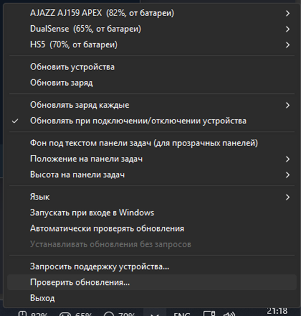
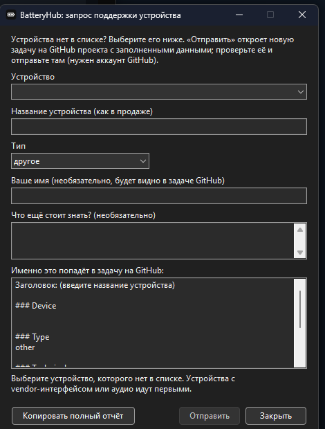
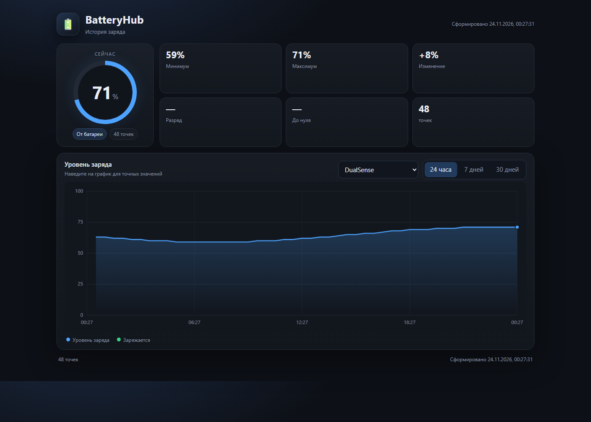

# BatteryHub

<p align="center">
  
</p>

<p align="center">
  <b>Заряд беспроводных устройств — прямо на панели задач Windows 10/11.</b><br>
  Мышь, наушники, геймпад и клавиатура. Без тяжёлого софта производителей.<br>
  <sub>Wireless device battery levels on the Windows taskbar — tiny Rust app, no vendor software.</sub>
</p>

<p align="center">
  
  
  
  
</p>

<p align="center">
  
</p>

<p align="center">
  <a href="../../releases/latest"></a>
</p>

> **По-русски:** это форк BatteryHub (Rust) с драйверами для **AJAZZ AJ159 APEX**, **Dark Project HS5 V2**, **AULA F75/F87/F99**, мышей **Attack Shark** и русским интерфейсом. Ниже — установка и поддерживаемые устройства. [Подробности на русском](README-RU.md).

---

## Возможности

- **Проценты рядом с часами** — иконка устройства + заряд, без наведения мышью.
- **Трей-режим** — если панель задач вертикальная или нестандартная.
- **Цвета состояния** — красный при низком заряде, ⚡ при зарядке, ✓ при 100%, приглушение во сне.
- **Свой порог** для каждого устройства: 50 / 40 / 30 / 20 / 15 / 10 / 5%.
- **Автообновление** раз в 1/5/10/30/60 минут и сразу при подключении/отключении.
- **Несколько мониторов** — виджет на всех, только на основном или на выбранном.
- **Положение и высота** — сдвиг влево от часов, вверх/вниз.
- **Русский и английский интерфейс** — переключение в меню, выбор сохраняется.
- **Уведомления** — низкий заряд, начало зарядки, 100%; галочка «Не беспокоить».
- **История заряда** — график за 24 часа / 7 / 30 дней, скорость разряда и время до нуля.
- **Автозапуск** с Windows и проверка обновлений (из этого репозитория).
- **Лёгкий**: около **0.2 МБ RAM** в простое, один exe, без службы и драйверов.

| Меню и пороги | Запрос поддержки устройства |
|:---:|:---:|
|  |  |

### История заряда

<p align="center">
  
</p>

История хранится локально 30 дней (TSV, одна точка в 30 минут). График открывается из меню
**История заряда...**: 24 часа / 7 дней / 30 дней, минимум/максимум, изменение, скорость разряда
и примерное время до нуля. Наведите на линию, чтобы увидеть точное время и процент.

---

## Поддерживаемые устройства

| Устройство | Подключение | Состояние |
|---|---|---|
| **AJAZZ AJ159 APEX** и AJ-серия на SONiX | 2.4 ГГц, `3151:5007` | ✅ Проверено на реальном железе |
| **Dark Project HS5 V2** | **Bluetooth** | ✅ Проверено; по 2.4 ГГц заряд не отдаётся |
| **Sony DualSense / DualShock 4** | USB / Bluetooth | ✅ Драйвер Sony |
| **AULA F75 / F87 Pro / F99** | 2.4 ГГц, `3554:FA09` | 🟡 Добавлено, на живом F75 не проверено |
| **Attack Shark** на Xenta | 2.4 ГГц, `1D57:FA60` | ✅ Протокол Xenta |
| **Attack Shark R3 и Rongyuan-мыши** | 2.4 ГГц, `3151:402D` и др. | 🟡 Добавлено по протоколу Rongyuan |
| Logitech, Razer, SteelSeries, Corsair, HyperX, Glorious, DualSense, Xbox, Bluetooth | — | ✅ Из upstream BatteryHub |

> **HS5 V2:** донгл 2.4 ГГц передаёт только звук, медиа-клавиши и канал прошивки — заряд в нём отсутствует. Спарьте наушники по **Bluetooth** один раз; режим 2.4 ГГц можно оставить для звука, гарнитура держит оба подключения одновременно.

---

## Установка

1. Скачайте **BatteryHub-Taskbar-Setup-v1.5.0.exe** из [Releases](../../releases/latest).
2. Запустите, выберите **Install**. Права администратора не нужны.
3. Готово: виджет появится слева от часов. Правый клик — меню.

Установка в `%LOCALAPPDATA%\Programs\BatteryHub\Taskbar`, автозапуск —
`HKCU\Software\Microsoft\Windows\CurrentVersion\Run\BatteryHub Taskbar`.

### Язык

Правый клик по процентам → **Язык** → **English** / **Русский**. Выбор хранится в
`HKCU\Software\BatteryHub\Taskbar\Language`; при первом запуске берётся язык Windows.

---

## Сборка

Нужны Rust 1.99+ (MSVC), Visual Studio Build Tools и Windows SDK.

```powershell
cargo build --release
.\target\release\batteryhub-taskbar.exe
```

Установщик:

```powershell
.\build-release.ps1
```

---

## Что добавлено в этой сборке

- `src/drivers/ajazz.rs` — AJAZZ AJ-серия: `SET_FEATURE 0xF7`, затем `GET_FEATURE 0x05`, заряд в байте 3.
- `src/drivers/aula.rs` — AULA F75/F87 Pro/F99: отчёт `0x13`, команда `0x4A`, сумма байт 0..18, заряд в байте 5.
- `src/drivers/rongyuan.rs` — Attack Shark R3 и другие Rongyuan-приёмники: `[00 F7]`, слоты клавиатуры/мыши.
- `src/i18n.rs` — русский/английский интерфейс, меню, трей-подсказки и окно запроса поддержки.
- `src/history.rs` — история заряда (TSV, 30 дней) и HTML-график с разрядом и прогнозом.
- Уведомления через трей и режим «Не беспокоить».
- Проверка обновлений теперь смотрит на `champion3k/batteryhub-rust`, а не на upstream.
- Обновлён `README-RU.md` и добавлены скриншоты в `docs/`.

---

## Ограничения

- Протоколы реверс-инжинирены сообществом; обновление прошивки устройства может их сломать.
- AULA и Rongyuan-мыши добавлены по протоколу, но не проверялись на живом железе в этой сборке.
- HS5 V2 по 2.4 ГГц не сообщает заряд — только Bluetooth.
- Приложение не заменяет фирменный софт для DPI, подсветки и макросов.

---

## Лицензия и благодарности

**GPL-3.0-or-later.** Полный текст — в [LICENSE](LICENSE).

Проект основан на:

- [ferloom/Wireless-Device-Battery-Monitor](https://github.com/ferloom/Wireless-Device-Battery-Monitor) — Rust-переписывание BatteryHub;
- [krisgfx9/Wireless-Device-Battery-Monitor](https://github.com/krisgfx9/Wireless-Device-Battery-Monitor) — оригинальный C++ BatteryHub (GPL-3.0);
- протоколы AULA — [PyFlat/Device-Battery-Info](https://github.com/PyFlat/Device-Battery-Info), [deepan-alve/womier-l65-linux](https://github.com/deepan-alve/womier-l65-linux);
- протокол Rongyuan — [qu1ncky/BatteryTray](https://github.com/qu1ncky/BatteryTray);
- протокол AJAZZ AJ-серии — [Aiacos/ajazz-control-center](https://github.com/Aiacos/ajazz-control-center) и сообщество.

Спасибо авторам оригинального BatteryHub и всем, кто реверс-инжинирил протоколы устройств.

<p align="center"><sub>Сделано с Rust и уважением к батарейкам.</sub></p>
